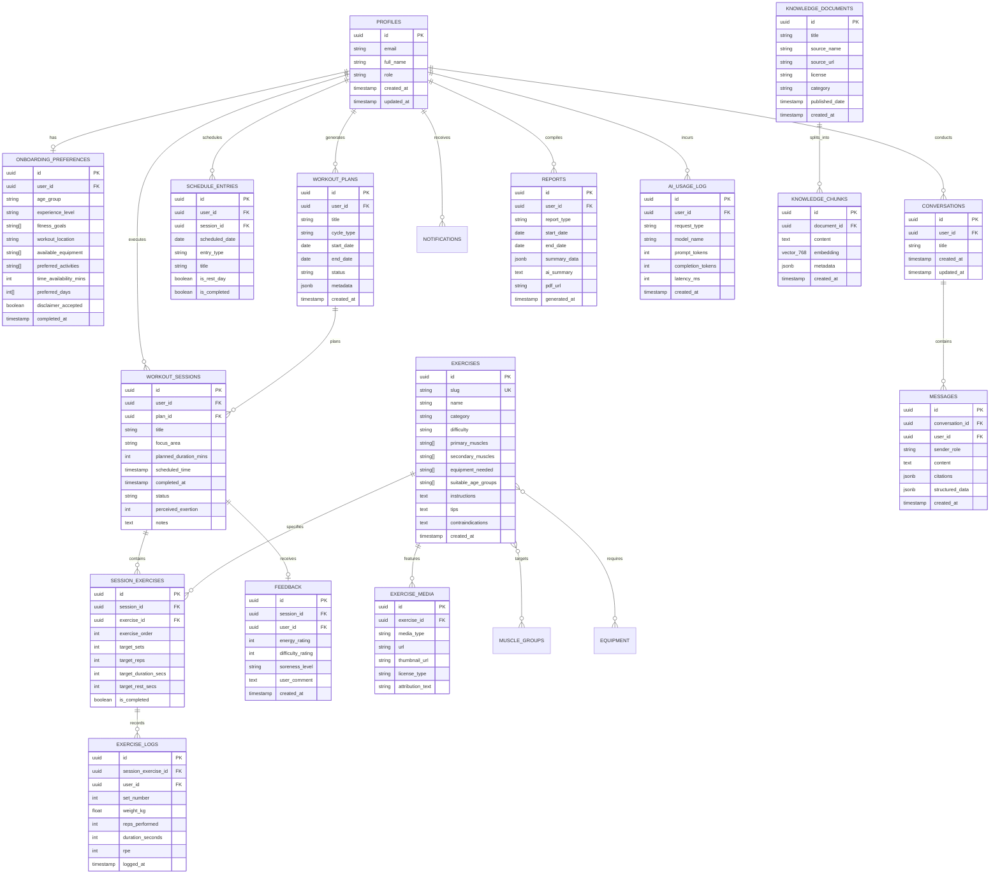

# Section 3: Database Schema, ERD & Row-Level Security (RLS)

## 1. Entity-Relationship Diagram (ERD)

The database schema is strictly normalized and enforced via PostgreSQL constraints, foreign keys, and Row-Level Security (RLS) policies.



---

## 2. Complete PostgreSQL Schema Plan & Constraints

The migration sequence is strictly ordered:

```sql
-- 1. Enable Required Extensions
CREATE EXTENSION IF NOT EXISTS "uuid-ossp";
CREATE EXTENSION IF NOT EXISTS "vector";

-- 2. Enumerated Custom Types
CREATE TYPE user_role AS ENUM ('user', 'admin');
CREATE TYPE age_group_enum AS ENUM ('minor_under_18', 'adult_18_64', 'senior_65_plus');
CREATE TYPE experience_level_enum AS ENUM ('beginner', 'intermediate', 'advanced');
CREATE TYPE workout_status_enum AS ENUM ('scheduled', 'in_progress', 'completed', 'skipped');
CREATE TYPE schedule_entry_type AS ENUM ('workout', 'active_recovery', 'rest_day');
CREATE TYPE sender_role_enum AS ENUM ('user', 'assistant', 'system');
CREATE TYPE media_type_enum AS ENUM ('image', 'gif', 'video');

-- 3. Profiles Table (Linked to Supabase auth.users)
CREATE TABLE profiles (
    id UUID PRIMARY KEY REFERENCES auth.users(id) ON DELETE CASCADE,
    email TEXT NOT NULL UNIQUE,
    full_name TEXT,
    role user_role DEFAULT 'user' NOT NULL,
    created_at TIMESTAMPTZ DEFAULT NOW() NOT NULL,
    updated_at TIMESTAMPTZ DEFAULT NOW() NOT NULL
);

-- 4. Onboarding Preferences Table
CREATE TABLE onboarding_preferences (
    id UUID PRIMARY KEY DEFAULT uuid_generate_v4(),
    user_id UUID NOT NULL UNIQUE REFERENCES profiles(id) ON DELETE CASCADE,
    age_group age_group_enum NOT NULL,
    experience_level experience_level_enum NOT NULL,
    fitness_goals TEXT[] NOT NULL DEFAULT '{}',
    workout_location TEXT NOT NULL,
    available_equipment TEXT[] NOT NULL DEFAULT '{}',
    preferred_activities TEXT[] NOT NULL DEFAULT '{}',
    time_availability_mins INT NOT NULL CHECK (time_availability_mins BETWEEN 10 AND 180),
    preferred_days INT[] NOT NULL CHECK (array_length(preferred_days, 1) BETWEEN 1 AND 7),
    disclaimer_accepted BOOLEAN NOT NULL DEFAULT FALSE,
    completed_at TIMESTAMPTZ,
    created_at TIMESTAMPTZ DEFAULT NOW() NOT NULL,
    updated_at TIMESTAMPTZ DEFAULT NOW() NOT NULL
);

-- 5. Exercises Reference Table (Public Read, Admin Write)
CREATE TABLE exercises (
    id UUID PRIMARY KEY DEFAULT uuid_generate_v4(),
    slug TEXT NOT NULL UNIQUE,
    name TEXT NOT NULL,
    category TEXT NOT NULL,
    difficulty experience_level_enum NOT NULL,
    primary_muscles TEXT[] NOT NULL DEFAULT '{}',
    secondary_muscles TEXT[] NOT NULL DEFAULT '{}',
    equipment_needed TEXT[] NOT NULL DEFAULT '{}',
    suitable_age_groups age_group_enum[] NOT NULL DEFAULT '{adult_18_64}',
    instructions TEXT NOT NULL,
    tips TEXT,
    contraindications TEXT,
    created_at TIMESTAMPTZ DEFAULT NOW() NOT NULL
);

-- 6. Exercise Media Table
CREATE TABLE exercise_media (
    id UUID PRIMARY KEY DEFAULT uuid_generate_v4(),
    exercise_id UUID NOT NULL REFERENCES exercises(id) ON DELETE CASCADE,
    media_type media_type_enum NOT NULL,
    url TEXT NOT NULL,
    thumbnail_url TEXT,
    license_type TEXT NOT NULL,
    attribution_text TEXT NOT NULL,
    created_at TIMESTAMPTZ DEFAULT NOW() NOT NULL
);

-- 7. Workout Plans Table
CREATE TABLE workout_plans (
    id UUID PRIMARY KEY DEFAULT uuid_generate_v4(),
    user_id UUID NOT NULL REFERENCES profiles(id) ON DELETE CASCADE,
    title TEXT NOT NULL,
    cycle_type TEXT NOT NULL DEFAULT 'weekly',
    start_date DATE NOT NULL,
    end_date DATE NOT NULL,
    status TEXT NOT NULL DEFAULT 'active',
    metadata JSONB DEFAULT '{}'::jsonb,
    created_at TIMESTAMPTZ DEFAULT NOW() NOT NULL,
    updated_at TIMESTAMPTZ DEFAULT NOW() NOT NULL
);

-- 8. Workout Sessions Table
CREATE TABLE workout_sessions (
    id UUID PRIMARY KEY DEFAULT uuid_generate_v4(),
    user_id UUID NOT NULL REFERENCES profiles(id) ON DELETE CASCADE,
    plan_id UUID REFERENCES workout_plans(id) ON DELETE SET NULL,
    title TEXT NOT NULL,
    focus_area TEXT NOT NULL,
    planned_duration_mins INT NOT NULL,
    scheduled_time TIMESTAMPTZ,
    completed_at TIMESTAMPTZ,
    status workout_status_enum NOT NULL DEFAULT 'scheduled',
    perceived_exertion INT CHECK (perceived_exertion BETWEEN 1 AND 10),
    notes TEXT,
    created_at TIMESTAMPTZ DEFAULT NOW() NOT NULL
);

-- 9. Session Exercises Table
CREATE TABLE session_exercises (
    id UUID PRIMARY KEY DEFAULT uuid_generate_v4(),
    session_id UUID NOT NULL REFERENCES workout_sessions(id) ON DELETE CASCADE,
    exercise_id UUID NOT NULL REFERENCES exercises(id) ON DELETE RESTRICT,
    exercise_order INT NOT NULL,
    target_sets INT NOT NULL CHECK (target_sets > 0),
    target_reps INT,
    target_duration_secs INT,
    target_rest_secs INT DEFAULT 60,
    is_completed BOOLEAN NOT NULL DEFAULT FALSE
);

-- 10. Exercise Logs Table
CREATE TABLE exercise_logs (
    id UUID PRIMARY KEY DEFAULT uuid_generate_v4(),
    session_exercise_id UUID NOT NULL REFERENCES session_exercises(id) ON DELETE CASCADE,
    user_id UUID NOT NULL REFERENCES profiles(id) ON DELETE CASCADE,
    set_number INT NOT NULL,
    weight_kg NUMERIC(6, 2) DEFAULT 0.0,
    reps_performed INT,
    duration_seconds INT,
    rpe INT CHECK (rpe BETWEEN 1 AND 10),
    logged_at TIMESTAMPTZ DEFAULT NOW() NOT NULL
);

-- 11. Schedule Entries Table
CREATE TABLE schedule_entries (
    id UUID PRIMARY KEY DEFAULT uuid_generate_v4(),
    user_id UUID NOT NULL REFERENCES profiles(id) ON DELETE CASCADE,
    session_id UUID REFERENCES workout_sessions(id) ON DELETE SET NULL,
    scheduled_date DATE NOT NULL,
    entry_type schedule_entry_type NOT NULL,
    title TEXT NOT NULL,
    is_rest_day BOOLEAN NOT NULL DEFAULT FALSE,
    is_completed BOOLEAN NOT NULL DEFAULT FALSE,
    created_at TIMESTAMPTZ DEFAULT NOW() NOT NULL
);

-- 12. Feedback Table
CREATE TABLE feedback (
    id UUID PRIMARY KEY DEFAULT uuid_generate_v4(),
    session_id UUID NOT NULL UNIQUE REFERENCES workout_sessions(id) ON DELETE CASCADE,
    user_id UUID NOT NULL REFERENCES profiles(id) ON DELETE CASCADE,
    energy_rating INT NOT NULL CHECK (energy_rating BETWEEN 1 AND 5),
    difficulty_rating INT NOT NULL CHECK (difficulty_rating BETWEEN 1 AND 5),
    soreness_level TEXT NOT NULL,
    user_comment TEXT,
    created_at TIMESTAMPTZ DEFAULT NOW() NOT NULL
);

-- 13. Conversations Table
CREATE TABLE conversations (
    id UUID PRIMARY KEY DEFAULT uuid_generate_v4(),
    user_id UUID NOT NULL REFERENCES profiles(id) ON DELETE CASCADE,
    title TEXT NOT NULL DEFAULT 'New Conversation',
    created_at TIMESTAMPTZ DEFAULT NOW() NOT NULL,
    updated_at TIMESTAMPTZ DEFAULT NOW() NOT NULL
);

-- 14. Messages Table
CREATE TABLE messages (
    id UUID PRIMARY KEY DEFAULT uuid_generate_v4(),
    conversation_id UUID NOT NULL REFERENCES conversations(id) ON DELETE CASCADE,
    user_id UUID NOT NULL REFERENCES profiles(id) ON DELETE CASCADE,
    sender_role sender_role_enum NOT NULL,
    content TEXT NOT NULL,
    citations JSONB DEFAULT '[]'::jsonb,
    structured_data JSONB DEFAULT '{}'::jsonb,
    created_at TIMESTAMPTZ DEFAULT NOW() NOT NULL
);

-- 15. Knowledge Documents Reference Table
CREATE TABLE knowledge_documents (
    id UUID PRIMARY KEY DEFAULT uuid_generate_v4(),
    title TEXT NOT NULL,
    source_name TEXT NOT NULL,
    source_url TEXT NOT NULL,
    license TEXT NOT NULL,
    category TEXT NOT NULL,
    published_date DATE,
    created_at TIMESTAMPTZ DEFAULT NOW() NOT NULL
);

-- 16. Knowledge Chunks Table (pgvector 768 Dimensions)
CREATE TABLE knowledge_chunks (
    id UUID PRIMARY KEY DEFAULT uuid_generate_v4(),
    document_id UUID NOT NULL REFERENCES knowledge_documents(id) ON DELETE CASCADE,
    content TEXT NOT NULL,
    embedding VECTOR(768) NOT NULL,
    metadata JSONB NOT NULL DEFAULT '{}'::jsonb,
    created_at TIMESTAMPTZ DEFAULT NOW() NOT NULL
);

-- 17. Reports Table
CREATE TABLE reports (
    id UUID PRIMARY KEY DEFAULT uuid_generate_v4(),
    user_id UUID NOT NULL REFERENCES profiles(id) ON DELETE CASCADE,
    report_type TEXT NOT NULL,
    start_date DATE NOT NULL,
    end_date DATE NOT NULL,
    summary_data JSONB NOT NULL DEFAULT '{}'::jsonb,
    ai_summary TEXT,
    pdf_url TEXT,
    generated_at TIMESTAMPTZ DEFAULT NOW() NOT NULL
);

-- 18. AI Usage Log Table
CREATE TABLE ai_usage_log (
    id UUID PRIMARY KEY DEFAULT uuid_generate_v4(),
    user_id UUID NOT NULL REFERENCES profiles(id) ON DELETE CASCADE,
    request_type TEXT NOT NULL,
    model_name TEXT NOT NULL,
    prompt_tokens INT NOT NULL DEFAULT 0,
    completion_tokens INT NOT NULL DEFAULT 0,
    latency_ms INT NOT NULL DEFAULT 0,
    created_at TIMESTAMPTZ DEFAULT NOW() NOT NULL
);
```

---

## 3. High-Performance Indexing Strategy

```sql
-- HNSW Vector Index for Knowledge Chunks (Cosine Distance)
CREATE INDEX idx_knowledge_chunks_embedding_hnsw 
ON knowledge_chunks 
USING hnsw (embedding vector_cosine_ops)
WITH (m = 16, ef_construction = 64);

-- Relational Lookups
CREATE INDEX idx_onboarding_preferences_user ON onboarding_preferences(user_id);
CREATE INDEX idx_workout_sessions_user_status ON workout_sessions(user_id, status);
CREATE INDEX idx_workout_sessions_scheduled ON workout_sessions(user_id, scheduled_time);
CREATE INDEX idx_session_exercises_session ON session_exercises(session_id);
CREATE INDEX idx_exercise_logs_session_exercise ON exercise_logs(session_exercise_id);
CREATE INDEX idx_exercise_logs_user ON exercise_logs(user_id);
CREATE INDEX idx_schedule_entries_user_date ON schedule_entries(user_id, scheduled_date);
CREATE INDEX idx_messages_conversation ON messages(conversation_id, created_at ASC);
CREATE INDEX idx_exercises_category_difficulty ON exercises(category, difficulty);
```

---

## 4. Row-Level Security (RLS) Policy Plan & Matrix

RLS is enabled on every table in the public schema without exception.

### 4.1 RLS Rules Matrix

| Table | SELECT Policy | INSERT Policy | UPDATE Policy | DELETE Policy |
| :--- | :--- | :--- | :--- | :--- |
| `profiles` | `auth.uid() = id` | `auth.uid() = id` | `auth.uid() = id` | Service Role Only |
| `onboarding_preferences` | `auth.uid() = user_id` | `auth.uid() = user_id` | `auth.uid() = user_id` | `auth.uid() = user_id` |
| `workout_plans` | `auth.uid() = user_id` | `auth.uid() = user_id` | `auth.uid() = user_id` | `auth.uid() = user_id` |
| `workout_sessions` | `auth.uid() = user_id` | `auth.uid() = user_id` | `auth.uid() = user_id` | `auth.uid() = user_id` |
| `session_exercises` | `EXISTS (workout_sessions)` | `EXISTS (workout_sessions)` | `EXISTS (workout_sessions)` | `EXISTS (workout_sessions)` |
| `exercise_logs` | `auth.uid() = user_id` | `auth.uid() = user_id` | `auth.uid() = user_id` | `auth.uid() = user_id` |
| `schedule_entries` | `auth.uid() = user_id` | `auth.uid() = user_id` | `auth.uid() = user_id` | `auth.uid() = user_id` |
| `feedback` | `auth.uid() = user_id` | `auth.uid() = user_id` | `auth.uid() = user_id` | `auth.uid() = user_id` |
| `conversations` | `auth.uid() = user_id` | `auth.uid() = user_id` | `auth.uid() = user_id` | `auth.uid() = user_id` |
| `messages` | `auth.uid() = user_id` | `auth.uid() = user_id` | `auth.uid() = user_id` | `auth.uid() = user_id` |
| `reports` | `auth.uid() = user_id` | `auth.uid() = user_id` | `auth.uid() = user_id` | `auth.uid() = user_id` |
| `ai_usage_log` | `auth.uid() = user_id` | Service Role Only | Service Role Only | Service Role Only |
| `exercises` | `TRUE` (Public Read) | Service Role Only | Service Role Only | Service Role Only |
| `exercise_media` | `TRUE` (Public Read) | Service Role Only | Service Role Only | Service Role Only |
| `knowledge_documents` | `TRUE` (Public Read) | Service Role Only | Service Role Only | Service Role Only |
| `knowledge_chunks` | `TRUE` (Public Read) | Service Role Only | Service Role Only | Service Role Only |

### 4.2 SQL Verification Test Protocol
RLS testing runs against both an authenticated session and an unauthorized session:
1. User A inserts row with `user_id = User A`.
2. User B executes `SELECT * WHERE user_id = User A` -> Expect zero rows returned.
3. User B executes `UPDATE ... WHERE user_id = User A` -> Expect zero rows affected.
4. User B executes `DELETE ... WHERE user_id = User A` -> Expect zero rows affected.
5. Anonymous client queries `exercises` -> Expect 200 OK with full public catalog.
6. Anonymous client queries `workout_sessions` -> Expect zero rows.
